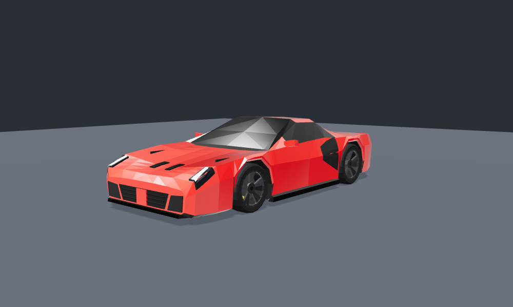
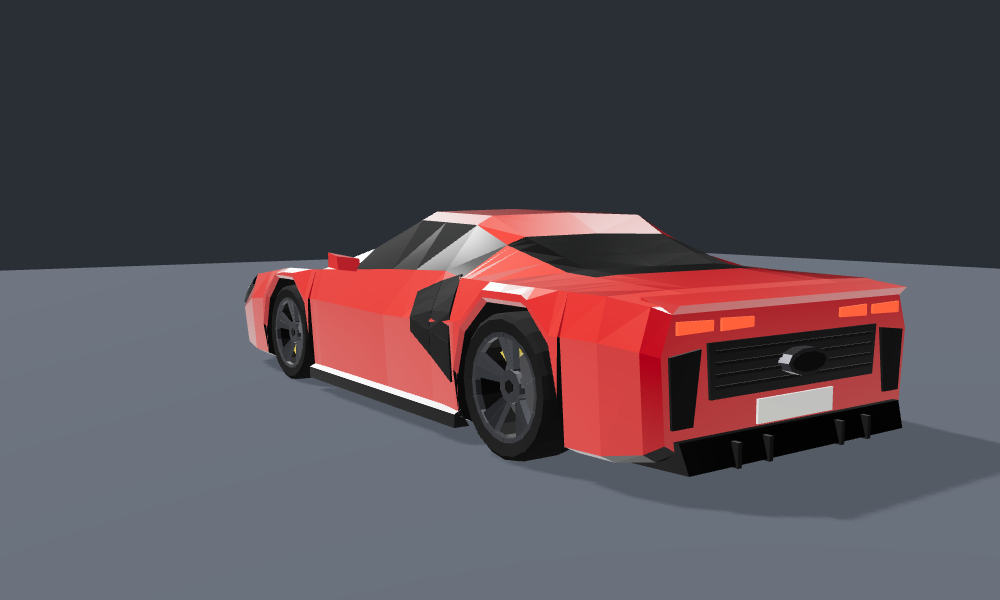
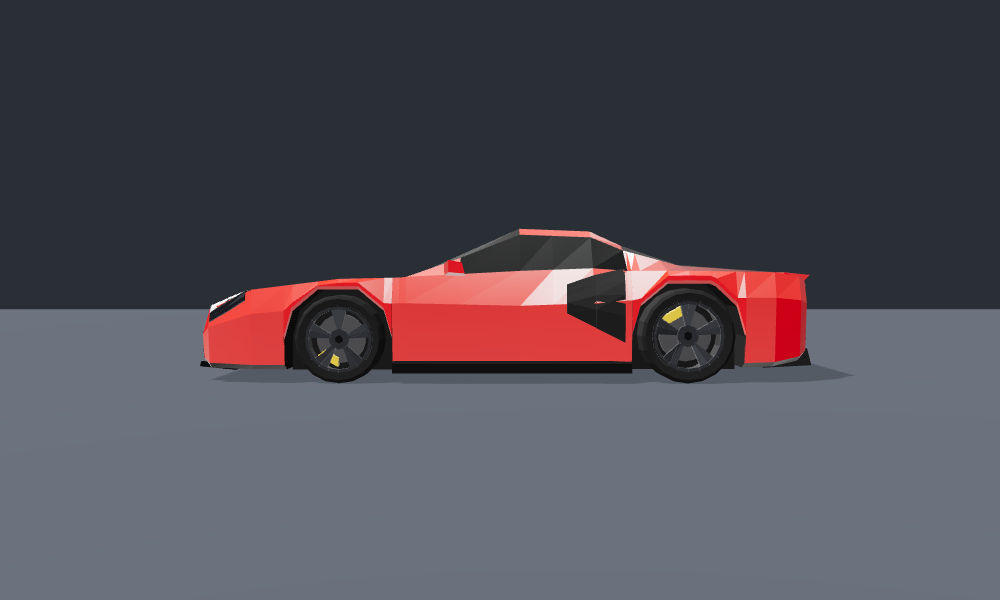

# Ferrari 296 – Low-Poly Game-Modell (für dildi City)

Ein Mittelmotor-Sportwagen mit den Proportionen eines Ferrari 296 GTB. Der Stil ist derselbe wie beim [RS6](../rs6/README.md): echte Maße, facettierte Flächen und Flat-Shading. Die beiden Autos passen damit optisch zusammen.





## Dateien

| Datei | Inhalt |
|---|---|
| `ferrari_296.glb` | Das Modell (glTF 2.0 binär) für Unity (glTFast), Godot, Unreal, Blender und three.js |
| `build_ferrari.py` | Generator. Er nutzt MeshBuilder, Export und Räder aus `../rs6/build_rs6.py`. |
| `viewer.html` | Vorschau im Browser, gestartet über einen lokalen Webserver, z. B. `python3 -m http.server` im Ordner `models/` |

## Technische Daten

- **ca. 5.600 Dreiecke** (Karosserie ~2.400, je Rad ~800)
- **Maße:** Länge 4,56 m, Breite 1,96 m, Höhe 1,19 m, Radstand 2,60 m
- **Ausrichtung:** 1 Einheit = 1 m, +Y oben, +Z vorne. Der Ursprung liegt auf dem Boden, mittig zwischen den Achsen.
- **Räder:** Vorne und hinten sind die Räder unterschiedlich groß, wie beim echten Auto:
  - vorne 245/35 R20: Radius 0,330 m, Position x ±0,83, z +1,20
  - hinten 305/35 R20: Radius 0,354 m, Position x ±0,82, z −1,40

### Hierarchie

```
Ferrari_296
├── Body          Karosserie, Lichter, Bremssättel (fest)
├── Wheel_FL/FR   Mesh "Wheel_Front", Pivot = Radmitte, dreht um lokale X-Achse
└── Wheel_RL/RR   Mesh "Wheel_Rear"
```

Die Materialnamen sind dieselben wie beim RS6 (`Paint`, `Glass`, `HeadLight`, `TailLight`, `Caliper` …). Skripte für Lackfarbe und Licht funktionieren daher bei beiden Autos gleich.

**Kollision:** Eine Box von etwa `1.96 × 1.08 × 4.56 m` mit dem Zentrum bei `(0, 0.64, −0.03)` reicht.

## Varianten

```bash
python3 build_ferrari.py                                      # Rosso Corsa, gelbe Bremssättel
python3 build_ferrari.py --paint 0.95,0.75,0.05 --caliper 0.05,0.05,0.05 --out ferrari_gelb.glb
python3 build_ferrari.py --paint 0.08,0.08,0.09 --caliper 0.8,0.05,0.04 --out ferrari_schwarz.glb
```

> Hinweis: Das Modell enthält keine Hersteller-Logos oder Schriftzüge. Die Kennzeichen sind leer.
