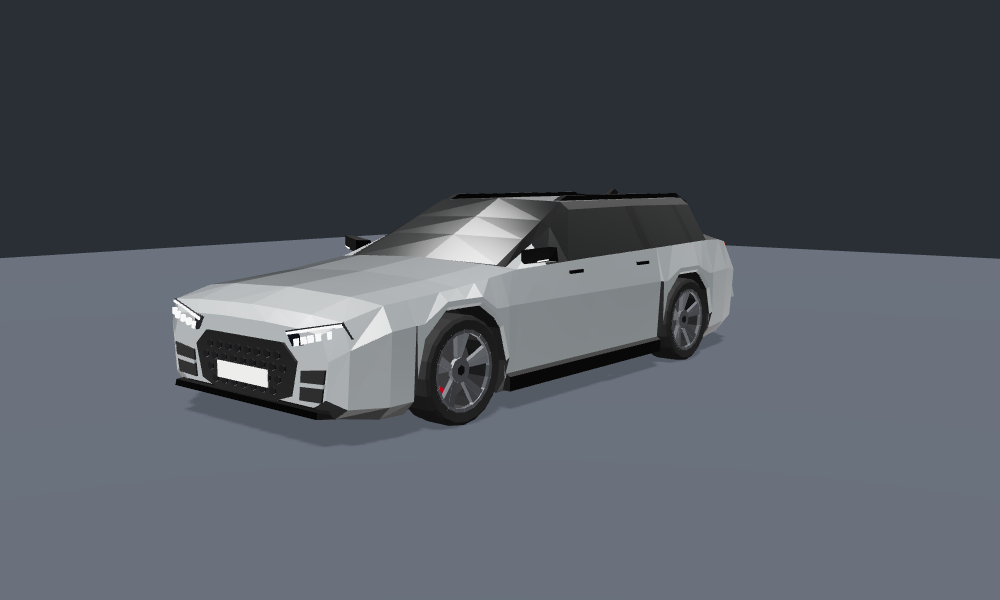
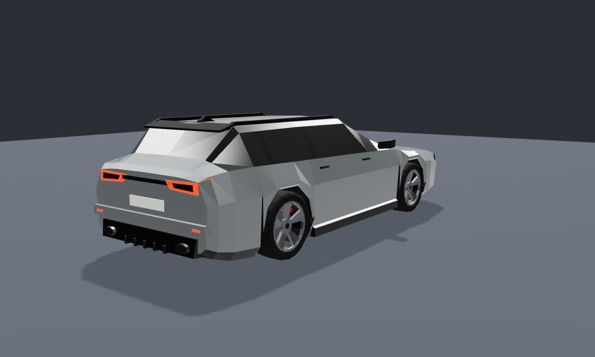
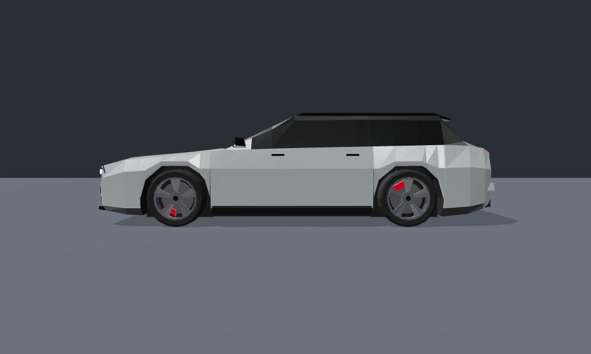

# RS6 Avant – Low-Poly Game-Modell

Das Modell hat die Proportionen eines RS6 Avant (C8) und ist für Spiele gebaut. Die Maße stimmen mit dem echten Auto überein. Die Flächen sind bewusst facettiert und flach schattiert, damit das Auto in eine kantige Low-Poly-Umgebung passt.





## Dateien

| Datei | Inhalt |
|---|---|
| `rs6_avant.glb` | Das Modell (glTF 2.0 binär). Funktioniert in Unity (über glTFast), Godot, Unreal, Blender und three.js. |
| `build_rs6.py` | Prozeduraler Generator. Damit lässt sich das Modell neu erzeugen oder verändern. |
| `viewer.html` | Vorschau im Browser mit Orbit-Steuerung, drehenden Rädern, Licht an/aus und Farbwähler. Sie braucht einen lokalen Webserver, z. B. `python3 -m http.server`. |

## Technische Daten

- **ca. 5.900 Dreiecke** insgesamt (Karosserie ~2.650, je Rad ~800)
- **Maßstab:** 1 Einheit = 1 m. Länge 4,99 m, Breite 1,95 m, Höhe 1,47 m (ohne Antenne), Radstand 2,93 m
- **Ausrichtung:** +Y oben, +Z vorne (glTF-Standard). Der Ursprung liegt auf dem Boden, mittig zwischen den Achsen.
- **Flat-Shading:** Jedes Dreieck hat eigene Normalen. Das ergibt die harten Kanten.
- **UVs:** Box-Projektion mit 1 UV = 1 m, z. B. für Schmutz- oder Decal-Texturen oder Lightmaps

### Hierarchie (für Fahrphysik)

```
RS6_Avant
├── Body          Karosserie, Lichter, Bremssättel (fest)
├── Wheel_FL      Pivot = Radmitte, dreht um lokale X-Achse
├── Wheel_FR      (um 180° um Y gedreht, Felgenseite nach außen)
├── Wheel_RL
└── Wheel_RR
```

Die Räder sind eigene Nodes mit dem Pivot in der Radmitte. Damit lassen sie sich direkt an WheelCollider (Unity) oder VehicleWheel3D (Godot) hängen. Für die Lenkung dreht man die Vorderräder um Y. Die Bremssättel gehören zur Karosserie und drehen nicht mit.

- Radradius 0,365 m, Reifenbreite 0,285 m (285/30 R22)
- Radpositionen: x = ±0,83, y = 0,365, z = +1,51 (vorne) / −1,42 (hinten)

### Materialien

Für jedes Material gibt es ein eigenes Primitive. Farben lassen sich deshalb im Spiel tauschen, ohne Texturen zu ändern.

`Paint` (Klarlack, Standard Nardo-Grau) · `Glass` · `TrimGloss` · `TrimMatte` · `Underbody` · `Grille` · `HeadLight` (emissiv) · `TailLight` (emissiv) · `LightLens` · `Plate` · `Exhaust` · `Tire` · `Rim` · `RimInner` · `BrakeDisc` · `Caliper`

Für Licht an/aus setzt man die Emission von `HeadLight` und `TailLight` auf 0 oder höher. Die Scheiben sind absichtlich opak und dunkel getönt. Das spart Transparenz-Sortierung, und ein Innenraum ist nicht nötig.

### Kollision

Für die Physik reicht eine Box von etwa `1.95 × 1.30 × 4.99 m` mit dem Zentrum bei `(0, 0.79, 0)`. Alternativ nimmt man einen konvexen Mesh-Collider aus `Body`.

## Neu generieren / anpassen

```bash
python3 build_rs6.py                          # Nardo-Grau
python3 build_rs6.py --paint 0.05,0.05,0.06 --out rs6_schwarz.glb
python3 build_rs6.py --paint 0.10,0.20,0.55 --out rs6_blau.glb
```

Benötigt wird nur Python 3 mit `numpy`. Die Form der Karosserie steht in der Tabelle `KEYS` als Querschnitte entlang der Fahrzeuglänge. Wer dort Werte ändert, verändert direkt die Silhouette. Weniger Stationen ergeben ein noch kantigeres Auto.

> Hinweis: Das Modell enthält bewusst keine Hersteller-Logos oder Schriftzüge. Die Kennzeichen sind leer.
